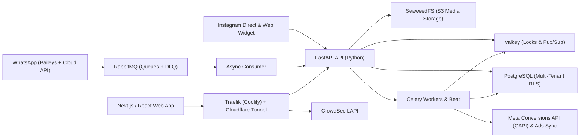

# Skorp CRM

[Português](#versao-em-portugues) | [English](#english-version)

> **Aviso de código privado:** Este repositório é a vitrine pública de arquitetura do Skorp CRM. O código-fonte é privado por ser um produto comercial em beta. Demonstração ao vivo sob pedido: [antonymsandrade@gmail.com](mailto:antonymsandrade@gmail.com) ou [LinkedIn](https://www.linkedin.com/in/antonyandrade01/).
>
> **Private repository notice:** This repository is the public architecture showcase for Skorp CRM. Source code is private because the product is in commercial beta. Live demos are available on request: [antonymsandrade@gmail.com](mailto:antonymsandrade@gmail.com) or [LinkedIn](https://www.linkedin.com/in/antonyandrade01/).

**No ar / Live:** [skorp.com.br](https://skorp.com.br) (site do produto; o app pede login / product site; the app requires login). Acesso de demonstração sob pedido / Demo access on request.

---

## Arquitetura / Architecture

---

## Versão em Português

### Problema que resolve

Equipes comerciais perdem o histórico e a origem dos atendimentos quando respondem WhatsApp, Instagram e formulário do site em ferramentas separadas. Webhooks repetidos duplicam mensagens, anúncios Click-to-WhatsApp da Meta chegam primeiro com um identificador anônimo (`@lid`) antes do telefone real, e os negócios fechados não voltam para a plataforma de anúncios.

O Skorp CRM reúne esses canais em um funil comercial multi-tenant, unifica contatos duplicados apenas com correspondência exata e envia conversões fechadas para a Meta Conversions API (CAPI). Desenvolvo com agentes de IA sob minha direção: defino a arquitetura, reviso o código e valido com testes automatizados.

### Números reais

- Em produção beta desde agosto de 2026, com clientes testando no dia a dia e equipe não técnica cuidando de implantação e vendas.
- Conecta 13 canais ativos: 5 instâncias WhatsApp via Baileys, 4 contas de Instagram, 3 widgets de site e 1 canal WhatsApp Cloud API.
- Registra cerca de 71 mil mensagens por mês (~2.400 por dia), somando 115 mil mensagens desde o início.
- Executa backup cifrado (AES-256) do banco de hora em hora com cópia externa e teste automático semanal de restauração validando tabelas e mensagens.

### Decisões técnicas e trade-offs

#### Isolamento multi-tenant com RLS e papel restrito

No PostgreSQL, superusuários ignoram políticas de Row-Level Security mesmo quando a regra está forçada na tabela. Por isso, a API e os workers do Celery conectam com um papel sem privilégio de superusuário, enquanto apenas o container de migrations roda como dono das tabelas. Cada requisição e tarefa define o tenant ativo na sessão do banco, e um hook no SQLAlchemy reaplica essa configuração se um `commit()` no meio da requisição abrir uma nova transação.

Trade-off: esquecer de definir o tenant faz a consulta voltar vazia em vez de vazar dados de outro cliente, mas exige cuidado em cada entrada de webhook e tarefa assíncrona. Tabelas consultadas antes do login permitem leitura na autenticação, mantendo escritas isoladas por tenant.

#### Travas no Valkey por canal e liberação segura

O WhatsApp gera o mesmo ID externo de mensagem nos dois lados de uma conversa e para todos os participantes de um grupo. Quando dois clientes do CRM conversavam entre si, uma trava global fazia o segundo tenant descartar mensagens legítimas. Incluir o ID do canal na chave de deduplicação resolveu o problema. Na criação concorrente de contatos, a trava grava um token único por tentativa e um script Lua só apaga a chave se o token ainda pertencer àquela execução, impedindo que um worker lento remova a trava de outro após o tempo limite.

Trade-off: o Valkey roda sem despejo automático de chaves para nunca apagar sessões de WhatsApp nem listas de tokens revogados. Ao atingir o limite de memória, ele recusa novas escritas em vez de descartar estado em silêncio. Se o Valkey ficar fora do ar, a criação de contatos segue sem trava e registra o erro em log para não parar o recebimento de mensagens.

#### Filas de entrada, limite de conexões e merge conservador de leads

Os eventos do WhatsApp (Baileys) entram pelo RabbitMQ com fila de erro (DLQ) e nome fixo de nó para o deploy não criar nós órfãos. A confirmação (`ack`) fica fora do tratamento de erro, evitando mandar mensagens já processadas para a DLQ durante quedas rápidas do canal. Os workers do Celery limitam seu pool de conexões por processo para não esgotar o limite do PostgreSQL.

Na unificação de leads vindos de anúncios da Meta (`@lid`), o sistema só junta dois cadastros quando o WhatsApp envia o identificador anônimo e o telefone real juntos em correspondência exata 1 para 1 (tratando DDI 55 e nono dígito). O hash de foto de perfil foi retirado do critério em outubro de 2026 porque logotipos de empresa podiam unir pessoas distintas. Duplicatas vão para soft delete preservando histórico de conversas e negócios. Eventos para a Meta CAPI são enfileirados somente após o commit da transação no banco.

#### Storage S3 em SeaweedFS e janela de deploy

Anexos de mídia ficam no SeaweedFS (licença Apache-2.0) fora do banco relacional. O pipeline no GitHub Actions bloqueia o deploy se falharem os scanners de segurança e checagem de licenças.

Trade-off: o deploy atual no Coolify (proxy Traefik) deixa o sistema fora do ar por cerca de 90 segundos porque usa um único Docker Compose com nomes fixos de container; reduzir essa janela está no backlog.

### O que está no ar

- Inbox omnichannel em tempo real via WebSockets (WhatsApp via Baileys com ajustes próprios, WhatsApp Cloud API, Instagram Direct e widget de site).
- Funil de vendas Kanban, gestão de contatos, reconciliação de `@lid`, envio de conversões para Meta CAPI e sincronização de dados do Meta Ads.
- Construtor visual de fluxos, formulários, agendamentos com lembretes automáticos, conformidade LGPD e proteção CrowdSec (sem blocklists públicas externas, removidas após bloquearem webhooks legítimos da Meta e faixas CGNAT).

---

## English Version

### Problem it solves

Sales teams lose conversation history and ad attribution when they answer WhatsApp, Instagram, and website forms in separate tools. Webhook retries duplicate messages, Meta Click-to-WhatsApp ads arrive with an anonymous identifier (`@lid`) before a real phone number appears, and closed deals never flow back to ad platforms.

Skorp CRM brings those channels into a multi-tenant sales pipeline, merges duplicate contacts only on exact proof, and sends conversion events back through Meta Conversions API (CAPI). I build with AI coding agents under my direction: I design the architecture, review the code, and validate behavior with automated tests.

### Real numbers

- In beta production since August 2026 with beta customers and a non-technical team handling onboarding and sales.
- Connects 13 active channels: 5 WhatsApp instances via Baileys, 4 Instagram accounts, 3 website widgets, and 1 WhatsApp Cloud API channel.
- Processes ~71,000 messages per month (~2,400/day), totaling 115,000 messages since launch.
- Runs hourly AES-256 encrypted database backups copied off-server and an automated weekly restore test checking tables and message integrity.

### Technical decisions and trade-offs

#### Multi-tenant isolation with PostgreSQL RLS and a restricted role

PostgreSQL superusers bypass Row-Level Security even when it is forced on a table. The API and Celery workers connect with a restricted non-superuser role, while only the migration container connects as the table owner. Every request and job binds the active tenant in the database session, and a SQLAlchemy hook reapplies it whenever a mid-request `commit()` opens a new transaction.

Trade-off: forgetting to set tenant context returns zero rows instead of leaking cross-tenant data, at the cost of requiring explicit setup in every webhook entrypoint and background job. Tables queried before login allow read lookups while keeping writes tenant-scoped.

#### Channel-scoped Valkey locks and safe release

WhatsApp reuses the same external message ID on both sides of a chat and across group members. When two CRM tenants messaged each other, a global deduplication lock caused the second tenant to drop legitimate messages. Adding the channel ID to the lock key solved this. For concurrent contact creation, each lock stores a unique token and a Lua script only deletes the key if the token still matches, preventing a slow worker from deleting another worker's lock after expiration.

Trade-off: Valkey runs with key eviction disabled so WhatsApp sessions and revoked JWT lists are never dropped silently. Hitting the memory cap raises an explicit error rather than losing state. If Valkey goes down, contact creation falls back to proceeding without the lock and logs the error so incoming messages keep flowing.

#### Inbound queues, bounded DB pools, and strict lead merge

WhatsApp (Baileys) events arrive over RabbitMQ with a dead-letter queue (DLQ) and a fixed node hostname so deploys do not create orphan broker nodes. Acknowledging a message (`ack`) sits outside the error handler so transient channel drops do not route saved messages to the DLQ. Celery workers cap their per-process database connection pools so they do not exhaust PostgreSQL limits.

For Meta Ads WhatsApp `@lid` leads, automatic merge runs only when WhatsApp delivers both the anonymous ID and the real phone number together with a 1-to-1 match (including Brazilian DDI 55 and 9th-digit rules). Profile-picture hashing was removed from merge matching in October 2026 because shared company logos could merge unrelated people. Merged duplicates are soft-deleted while preserving conversation and deal history. Meta CAPI events queue only after the database transaction commits.

#### SeaweedFS S3 storage and known deploy window

Media attachments are stored in SeaweedFS (Apache-2.0 license) outside the relational database. The GitHub Actions CI pipeline blocks deployment if security scanners or license checks fail.

Trade-off: production deploys through Coolify (Traefik proxy) currently take ~90 seconds of downtime due to fixed container names in a single Compose stack; reducing that window is on the backlog.

### What is live

- Real-time omnichannel inbox over WebSockets (WhatsApp via patched Baileys, WhatsApp Cloud API, Instagram Direct, and website widget).
- Kanban sales pipeline, contact management, `@lid` identity reconciliation, Meta CAPI conversion dispatch, and Meta Ads data sync.
- Visual flow builder, web forms, appointment reminders, LGPD data-handling tools, and CrowdSec protection (external public blocklists were dropped after blocking legitimate Meta webhooks and mobile CGNAT ranges).
