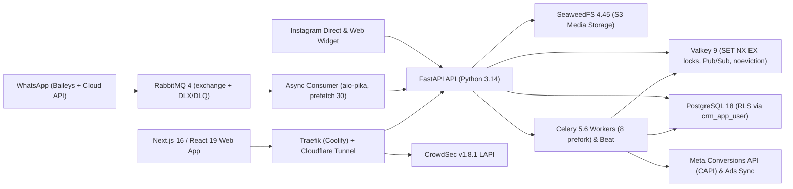

# Skorp CRM

[Português](#versao-em-portugues) | [English](#english-version)

> **Aviso de código privado:** Este repositório é a vitrine pública de arquitetura do Skorp CRM. O código-fonte é privado por ser um produto comercial em beta. Demonstração ao vivo sob pedido: [antonymsandrade@gmail.com](mailto:antonymsandrade@gmail.com) ou [LinkedIn](https://www.linkedin.com/in/antonyandrade01/).
>
> **Private repository notice:** This repository is the public architecture showcase for Skorp CRM. Source code is private because the product is in commercial beta. Live demos are available on request: [antonymsandrade@gmail.com](mailto:antonymsandrade@gmail.com) or [LinkedIn](https://www.linkedin.com/in/antonyandrade01/).

**No ar / Live:** [skorp.com.br](https://skorp.com.br) (site do produto; o app pede login / product site; the app requires login). Acesso de demonstração sob pedido / Demo access on request.

---

## Arquitetura / Architecture

---

## Versão em Português

### Problema que resolve

Pequenas e médias equipes comerciais perdem histórico e atribuição quando atendem pelo WhatsApp pessoal, Instagram e formulário do site ao mesmo tempo. Mensagens chegam duplicadas em reentregas de webhook, anúncios Click-to-WhatsApp da Meta entregam identificadores anônimos (`@lid`) antes do telefone real, e a venda fechada nunca volta para a plataforma de anúncios melhorar a segmentação.

O Skorp CRM centraliza o atendimento omnichannel em um funil comercial multi-tenant, reconcilia identidades de leads com regra conservadora e envia eventos de conversão de volta para a Meta Conversions API (CAPI). O desenvolvimento usa agentes de IA sob minha direção: defino a arquitetura, reviso o código e valido com testes automatizados.

### Números reais

- Opera em produção beta desde agosto de 2026, com clientes beta reais e equipe não técnica cuidando de implantação e comercial.
- Conecta 13 canais ativos: 5 instâncias WhatsApp via Baileys, 4 contas de Instagram, 3 widgets de site e 1 canal WhatsApp Cloud API.
- Registra cerca de 3.000 contatos, 1.383 conversas e 115.000 mensagens acumuladas, sendo 71.000 mensagens em 30 dias (média de ~2.400 por dia).
- Mantém 100 migrations Alembic, 102 arquivos de teste Pytest no backend e 17 arquivos de teste unitário no frontend (além de testes E2E em Playwright).
- Executa backup cifrado (AES-256) do banco de hora em hora (RPO de 1 hora) com cópia externa e teste automático semanal de restauração validando 57 tabelas, versão do Alembic e pelo menos 95% das mensagens.

### Decisões técnicas e trade-offs

#### Isolamento multi-tenant com RLS e papel não-superusuário

Todas as tabelas multi-tenant aplicam Row-Level Security no PostgreSQL 18. A API, o Celery worker e o Celery beat conectam usando um papel dedicado (`crm_app_user`) sem privilégio de superusuário, enquanto apenas o container one-shot `migration` usa o papel dono para rodar DDL. A sessão injeta o tenant via `SELECT set_config('app.current_tenant_id', :tid, true)` e um listener `after_begin` no SQLAlchemy reaplica a variável sempre que uma nova transação abre após um `commit()` no meio da requisição.

Trade-off: esquecer de definir o contexto de tenant faz a consulta devolver zero linhas em vez de vazar dado de outro cliente, mas exige disciplina em jobs assíncronos e webhooks. Tabelas consultadas antes da autenticação (`users` no login e `channels` na entrada de webhooks) têm política de `SELECT` permissiva e escrita isolada por tenant.

#### Trava distribuída no Valkey por canal e liberação segura em Lua

A deduplicação de webhooks usa `SET NX EX 60` na chave `lock:{channel.id}:{message_type}:{external_id}`. Incluir `channel.id` resolveu um erro observado em produção: o WhatsApp gera o mesmo `key.id` nos dois lados de uma conversa e para todos os participantes de um grupo, então uma trava global fazia o segundo tenant descartar mensagens legítimas. Na criação de contatos concorrentes, a trava usa um token UUID por tentativa e é liberada por script Lua compare-and-delete, impedindo que um worker atrasado apague a trava de outro após o TTL expirar. Se o Valkey ficar indisponível, o fluxo segue em modo fail-open com log explícito para não parar a recepção de mensagens.

Trade-off: o Valkey roda com `maxmemory 768mb` e política `noeviction`. Ao bater o teto de memória, o broker rejeita novas escritas em vez de apagar silenciosamente sessões do WhatsApp e listas de revogação de JWT. Isso prefere erro visível a perda silenciosa de estado.

#### Filas separadas, pool controlado e merge de leads só com prova exata

Eventos do WhatsApp (Baileys) chegam pelo RabbitMQ 4 (`aio-pika`, `prefetch_count=30`, DLX/DLQ e hostname fixo `rabbit@rabbitmq` para evitar nós órfãos a cada deploy). O `ack()` fica fora do bloco `try/except` que chama `reject(requeue=False)`, evitando mandar eventos já processados para a Dead Letter Queue quando ocorre instabilidade momentânea no canal. O Celery roda com 8 workers prefork, `task_acks_late=True`, descarte de pool herdado no `worker_process_init` e limite de `3+2` conexões por filho para não exceder `max_connections` do PostgreSQL.

Na reconciliação de leads (`@lid` da Meta com telefone real, cobrindo DDI 55 e nono dígito), o sistema só funde dois cadastros quando WhatsApp entrega telefone e LID juntos na mesma mensagem e o casamento é 1 para 1, sem ambiguidade. O hash de foto de perfil (`profile_pic_hash`) foi retirado do critério de merge em outubro de 2026 porque logotipos de empresa e imagens padrão causavam fusões incorretas entre pessoas distintas. Registros mesclados recebem soft delete com `merged_into_id` preservando o histórico de conversas, negócios e reuniões. Eventos da Meta CAPI são enfileirados via listener `after_commit` do SQLAlchemy para nunca rodarem antes da gravação real do negócio.

#### Armazenamento S3 em SeaweedFS e janela de deploy conhecida

Anexos de mídia saem do banco relacional e vão para o SeaweedFS 4.45 (licença Apache-2.0). O pipeline de CI no GitHub Actions bloqueia o deploy quando falham scanners de segurança (Gitleaks, Semgrep, Bandit, Trivy, OSV-Scanner, Hadolint, ShellCheck, Checkov e checagem de licenças). O deploy atual no Coolify (proxy Traefik) tem cerca de 90 segundos de indisponibilidade porque usa um único Docker Compose com nomes fixos de container; reduzir essa janela de queda está no backlog.

### Em produção vs. em teste

Em produção (beta):
- Inbox omnichannel em tempo real via WebSockets (WhatsApp via Baileys com patches próprios, WhatsApp Cloud API, Instagram Direct e widget de site).
- Funil de vendas Kanban, gestão de contatos, reconciliação de `@lid`, envio de conversões para Meta CAPI e sincronização de insights do Meta Ads.
- Construtor visual de fluxos, formulários, agendamentos com lembretes automáticos, conformidade LGPD e proteção CrowdSec LAPI (com blocklists públicas removidas após bloquearem webhooks legítimos da Meta e faixas CGNAT).

Em teste (sem clientes em produção):
- Aplicativo mobile em React Native (Expo).
- Extensão de navegador para apoio em reuniões no Google Meet.
- Integração de canal Telegram e telefonia VoIP.

---

## English Version

### Problem it solves

Small and midsize sales teams lose message history and ad attribution when they handle leads across WhatsApp, Instagram, and website forms in disconnected tools. Webhook retries create duplicate messages, Meta Click-to-WhatsApp ads deliver anonymous identifiers (`@lid`) before a real phone number appears, and closed deals never flow back to ad platforms.

Skorp CRM brings those channels into a multi-tenant sales pipeline, merges lead identities conservatively, and sends conversion events back through Meta Conversions API (CAPI). I build with AI coding agents under my direction: I design the architecture, review the code, and validate behavior with automated tests.

### Real numbers

- Running in beta production since August 2026 with beta customers and a non-technical team handling onboarding and sales.
- Connects 13 active channels: 5 WhatsApp instances via Baileys, 4 Instagram accounts, 3 website widgets, and 1 WhatsApp Cloud API channel.
- Holds ~3,000 contacts, 1,383 conversations, and 115,000 total messages, including 71,000 messages in 30 days (~2,400/day).
- Maintains 100 Alembic migrations, 102 backend Pytest test files, and 17 frontend unit test suites (plus Playwright E2E specs).
- Runs hourly AES-256 encrypted database backups (1-hour RPO) copied off-server and an automated weekly restore test checking 57 tables, Alembic head version, and at least 95% of messages.

### Technical decisions and trade-offs

#### Multi-tenant isolation with PostgreSQL RLS and a non-superuser role

All multi-tenant tables enforce Row-Level Security in PostgreSQL 18. The API, Celery workers, and beat connect as a restricted role (`crm_app_user`), because PostgreSQL superusers bypass RLS even when `FORCE ROW LEVEL SECURITY` is set. Only the one-shot `migration` container connects as the table owner. Every session binds the tenant through `SELECT set_config('app.current_tenant_id', :tid, true)`, and a SQLAlchemy `after_begin` listener reapplies the GUC whenever a new transaction begins after a mid-request `commit()`.

Trade-off: forgetting to set tenant context returns zero rows instead of leaking cross-tenant data, at the cost of requiring explicit context setup in every background task and webhook entrypoint. Unauthenticated lookup tables (`users` during login, `channels` on inbound webhooks) allow permissive `SELECT` while keeping writes tenant-scoped.

#### Channel-scoped Valkey locks and Lua compare-and-delete release

Webhook deduplication uses atomic `SET NX EX 60` on `lock:{channel.id}:{message_type}:{external_id}`. Including `channel.id` fixed a real production incident: WhatsApp reuses the same `key.id` on both sides of a chat and across group members, so a global lock caused one tenant to drop messages when two tenants messaged each other. Contact creation uses a separate per-identity lock with a unique UUID token released via an atomic Lua compare-and-delete script so a slow worker whose TTL expired cannot delete another worker's lock. If Valkey fails, contact creation falls back to fail-open with explicit error logging so message ingestion keeps moving.

Trade-off: Valkey runs with `maxmemory 768mb` and `noeviction`. Hitting the cap raises an explicit error rather than silently evicting WhatsApp pairing state or JWT revocation blacklists.

#### Separated queues, bounded DB pools, and proof-only lead merge

WhatsApp (Baileys) events arrive over RabbitMQ 4 (`aio-pika`, `prefetch_count=30`, DLX/DLQ, fixed node hostname `rabbit@rabbitmq` so Coolify deploys do not leave orphan broker nodes). Calling `ack()` stays outside the `try/except` block that triggers `reject(requeue=False)`, preventing already-processed messages from entering the DLQ on transient channel drops. Celery runs 8 prefork workers with `task_acks_late=True`, disposes inherited pools on `worker_process_init`, and bounds each child pool to `3+2` connections to protect PostgreSQL `max_connections`.

Identity reconciliation matches Meta Ads WhatsApp `@lid` records to real phone numbers (including Brazilian DDI 55 and 9th-digit variants) only when WhatsApp delivers both values together and the match is strictly 1-to-1. Avatar hashing (`profile_pic_hash`) was removed from merge matching in October 2026 because shared company logos and default icons could merge unrelated contacts. Merged duplicates are soft-deleted with `merged_into_id` while moving conversations, messages, deals, and meeting records to the surviving contact. Meta CAPI dispatches queue through a SQLAlchemy `after_commit` listener so workers never read uncommitted deals.

#### SeaweedFS S3 storage and known deploy window

Media attachments live in SeaweedFS 4.45 (chosen for its Apache-2.0 license). The GitHub Actions CI pipeline blocks deployment if security checks fail (Gitleaks, Semgrep, Bandit, Trivy, OSV-Scanner, Hadolint, ShellCheck, Checkov, and license compliance). Production deploys through Coolify (Traefik proxy) currently incur ~90 seconds of downtime because of fixed container names in a single Docker Compose stack; reducing that deploy window is on the backlog.

### Production vs. in testing

In production (beta):
- Real-time omnichannel inbox over WebSockets (WhatsApp via patched Baileys, WhatsApp Cloud API, Instagram Direct, and website widget).
- Kanban sales pipeline, contact management, `@lid` identity reconciliation, Meta CAPI conversion dispatch, and Meta Ads insights sync.
- Visual flow builder, web forms, appointment reminders, LGPD data-handling tools, and CrowdSec LAPI rules (external public blocklists were dropped after blocking legitimate Meta webhooks and mobile CGNAT ranges).

In testing (not used by production customers):
- React Native (Expo) mobile app.
- Browser extension for Google Meet session notes.
- Telegram channel integration and VoIP.
